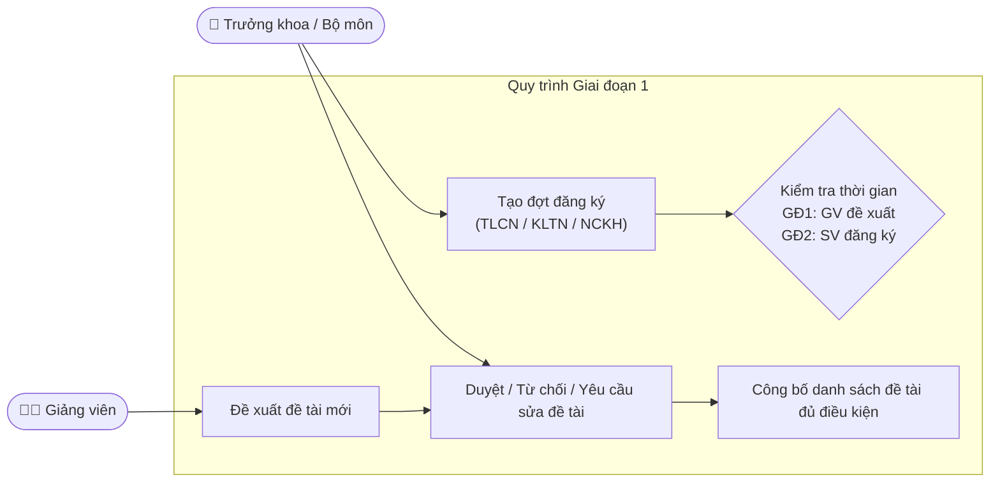
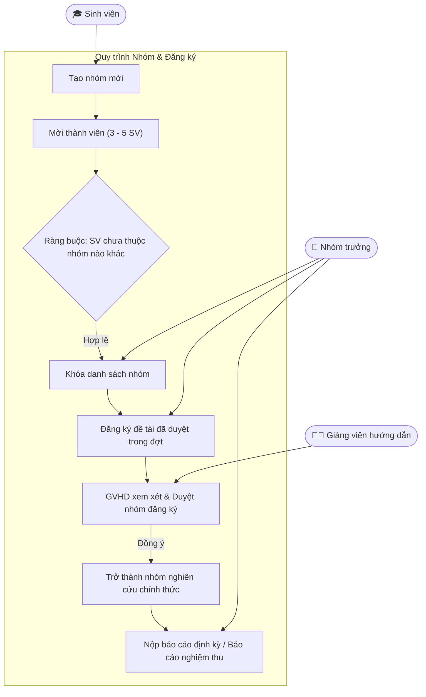
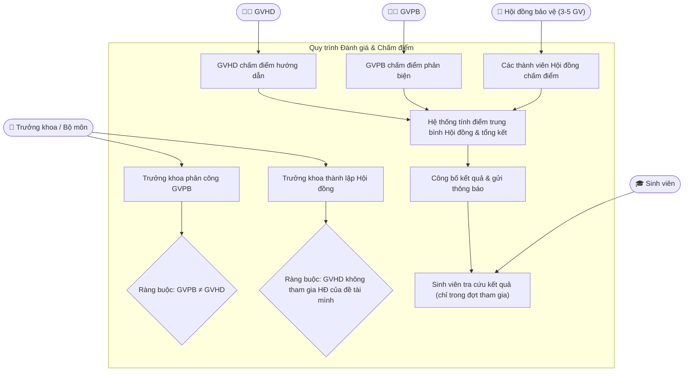

# Sơ đồ Use Case Hệ thống Quản lý Đề tài Nghiên cứu Khoa học & Khóa luận

## 1. Tác nhân Hệ thống (System Actors)

| Tác nhân (Actor) | Vai trò & Trách nhiệm chính |
|---|---|
| **Sinh viên (Student)** | Xem đợt mở, tạo nhóm (3-5 SV), mời thành viên, đăng ký đề tài, nộp báo cáo tiến độ, tra cứu điểm & kết quả của đợt mình tham gia. |
| **Giảng viên (Lecturer)** | Đề xuất đề tài, duyệt nhóm SV đăng ký, hướng dẫn SV, nộp điểm GVHD, nộp điểm GVPB, tham gia chấm điểm Hội đồng. |
| **Trưởng khoa / Bộ môn (Department Head)** | Quản lý đợt đăng ký 2 giai đoạn, duyệt đề tài của giảng viên, phân công GVPB, thành lập Hội đồng bảo vệ (3-5 GV, loại trừ GVHD), công bố điểm & kết quả. |
| **Quản trị viên (Admin)** | Quản lý người dùng, phân quyền vai trò (Role), quản lý danh mục Khoa/Bộ môn/Chuyên ngành, giám sát hệ thống. |

---

## 2. Sơ đồ Use Case Tổng quan (Global Use Case Diagram)

```mermaid
graph TD
    %% Actors
    Admin(["👤 Quản trị viên (Admin)"])
    DeptHead(["👔 Trưởng khoa / Bộ môn (Dept Head)"])
    Lecturer(["👨‍🏫 Giảng viên (Lecturer)"])
    Student(["🎓 Sinh viên (Student)"])

    %% Use Cases Sinh viên
    subgraph UC_Student ["Phân hệ Sinh viên"]
        UC_S1["UC-S01: Xem đợt đăng ký đang mở"]
        UC_S2["UC-S02: Tạo nhóm sinh viên (3-5 SV)"]
        UC_S3["UC-S03: Mời & quản lý thành viên nhóm"]
        UC_S4["UC-S04: Đăng ký đề tài được duyệt"]
        UC_S5["UC-S05: Nộp báo cáo tiến độ / khóa luận"]
        UC_S6["UC-S06: Tra cứu điểm & kết quả đợt"]
    end

    %% Use Cases Giảng viên
    subgraph UC_Lecturer ["Phân hệ Giảng viên"]
        UC_L1["UC-L01: Đề xuất đề tài mới"]
        UC_L2["UC-L02: Quản lý & chỉnh sửa đề tài"]
        UC_L3["UC-L03: Duyệt nhóm SV đăng ký đề tài"]
        UC_L4["UC-L04: Theo dõi & nhận xét báo cáo SV"]
        UC_L5["UC-L05: Nhập điểm GVHD"]
        UC_L6["UC-L06: Nhập điểm GVPB (phản biện)"]
        UC_L7["UC-L07: Nhập điểm Hội đồng bảo vệ"]
    end

    %% Use Cases Trưởng khoa
    subgraph UC_DeptHead ["Phân hệ Trưởng khoa / Bộ môn"]
        UC_D1["UC-D01: Tạo & quản lý đợt đăng ký (2 giai đoạn)"]
        UC_D2["UC-D02: Phê duyệt đề tài của giảng viên"]
        UC_D3["UC-D03: Phân công Giảng viên phản biện (GVPB)"]
        UC_D4["UC-D04: Thành lập Hội đồng bảo vệ (3-5 GV, trừ GVHD)"]
        UC_D5["UC-D05: Phân công đề tài vào Hội đồng"]
        UC_D6["UC-D06: Tổng hợp bảng điểm & Công bố kết quả"]
    end

    %% Use Cases Admin
    subgraph UC_Admin ["Phân hệ Quản trị hệ thống"]
        UC_A1["UC-A01: Quản lý người dùng & cấp tài khoản"]
        UC_A2["UC-A02: Phân quyền vai trò (Role-based)"]
        UC_A3["UC-A03: Quản lý danh mục Khoa, Bộ môn, Chuyên ngành"]
        UC_A4["UC-A04: Giám sát hệ thống (Actuator Metrics, Logs)"]
    end

    %% Use Case Chung
    subgraph UC_Common ["Xác thực & Chung"]
        UC_C1["UC-C01: Đăng nhập (Local / Google OAuth2)"]
        UC_C2["UC-C02: Đổi mật khẩu & cập nhật hồ sơ cá nhân"]
        UC_C3["UC-C03: Trợ lý AI hỏi đáp quy chế & đề tài"]
    end

    %% Connections Admin
    Admin --> UC_C1
    Admin --> UC_C2
    Admin --> UC_A1
    Admin --> UC_A2
    Admin --> UC_A3
    Admin --> UC_A4

    %% Connections DeptHead
    DeptHead --> UC_C1
    DeptHead --> UC_C2
    DeptHead --> UC_C3
    DeptHead --> UC_D1
    DeptHead --> UC_D2
    DeptHead --> UC_D3
    DeptHead --> UC_D4
    DeptHead --> UC_D5
    DeptHead --> UC_D6

    %% Connections Lecturer
    Lecturer --> UC_C1
    Lecturer --> UC_C2
    Lecturer --> UC_C3
    Lecturer --> UC_L1
    Lecturer --> UC_L2
    Lecturer --> UC_L3
    Lecturer --> UC_L4
    Lecturer --> UC_L5
    Lecturer --> UC_L6
    Lecturer --> UC_L7

    %% Connections Student
    Student --> UC_C1
    Student --> UC_C2
    Student --> UC_C3
    Student --> UC_S1
    Student --> UC_S2
    Student --> UC_S3
    Student --> UC_S4
    Student --> UC_S5
    Student --> UC_S6
```

---

## 3. Sơ đồ Use Case Chi tiết từng Phân hệ Nghiệp vụ

### 3.1. Phân hệ 1: Quản lý Đợt đăng ký & Phê duyệt đề tài (Giai đoạn 1)

### 3.2. Phân hệ 2: Đăng ký Nhóm & Đăng ký Đề tài (Giai đoạn 2)

### 3.3. Phân hệ 3: Đánh giá, Chấm điểm & Hội đồng bảo vệ

---

## 4. Bảng Đặc tả Các Ràng buộc Nghiệp vụ cốt lõi (Business Rules)

| Mã Use Case | Nghiệp vụ chính | Ràng buộc kỹ thuật & quy chế (Rubric / Đề bài) |
|---|---|---|
| **UC-D01** | Tạo đợt đăng ký 2 giai đoạn | Giai đoạn 1 (Đề xuất & duyệt đề tài) phải diễn ra trước Giai đoạn 2 (SV đăng ký). TLCN/KLTN mới có hạn nộp điểm GVPB; chỉ KLTN mới có ngày bảo vệ Hội đồng. |
| **UC-S02, S03** | Tạo nhóm sinh viên | Nhóm có từ **3 đến 5 sinh viên**, có đúng **1 nhóm trưởng**. Mỗi sinh viên chỉ được tham gia tối đa **1 nhóm duy nhất** trong cùng một đợt. |
| **UC-D03** | Phân công GVPB | Giảng viên phản biện phải thuộc cùng khoa/bộ môn và **tuyệt đối không được là GVHD** của đề tài đó. |
| **UC-D04** | Thành lập Hội đồng | Hội đồng có từ **3 đến 5 giảng viên**. **Loại trừ toàn bộ GVHD** khỏi hội đồng chấm đề tài của mình (ràng buộc xung đột lợi ích bắt buộc). |
| **UC-S06** | Tra cứu điểm & kết quả | Sinh viên **chỉ được phép tra cứu điểm** của đợt mà nhóm mình đăng ký tham gia; không được xem điểm của các đợt khác. |
